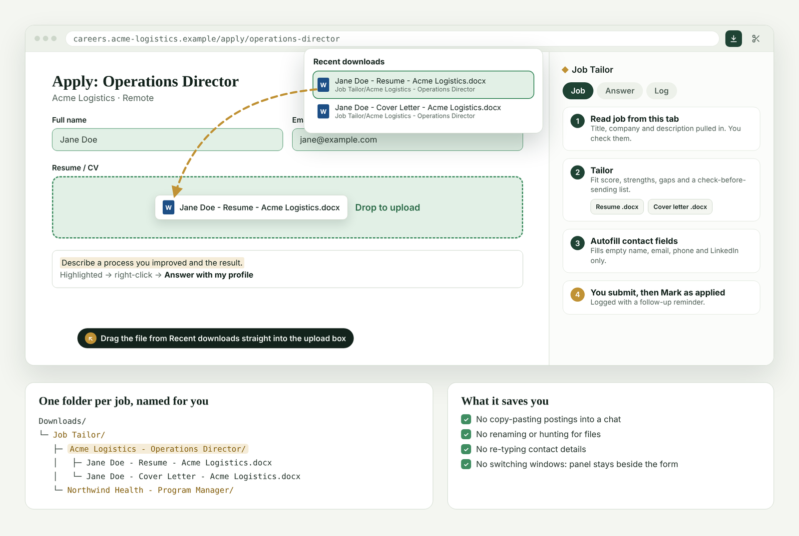
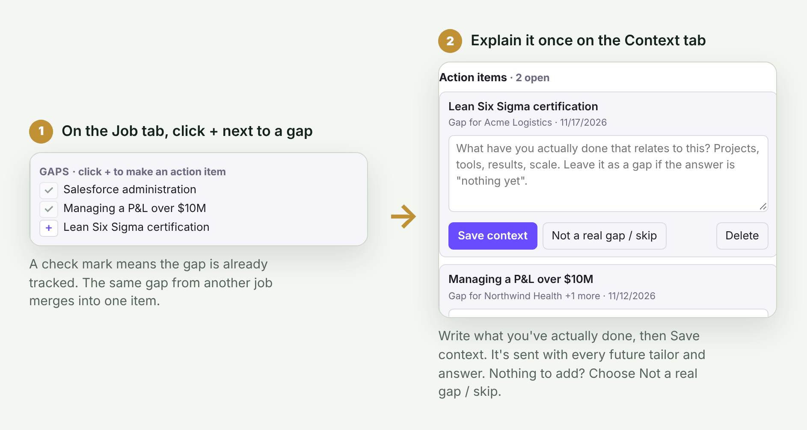

# Job Tailor

**A browser extension that helps you apply for jobs faster, without turning you into a bot.**

Job Tailor reads the job posting you have open, then drafts a tailored resume and cover letter from *your own* career record. It also drafts answers to application questions and keeps a log of where you've applied. Then it stops. You review, edit and submit every application yourself.

Works in **Brave, Google Chrome and Microsoft Edge** (any Chromium browser, version 116 or later).

> **Human augmentation, not botting.** Job Tailor never searches for jobs, never applies in bulk and never clicks submit. It won't answer salary, work-authorization, eligibility or EEO questions for you, and it won't invent experience. You stay in charge of everything that goes out under your name.

---

## Quick start

1. **Download it.** Click the green **Code** button above → **Download ZIP**, then unzip it somewhere permanent (for example `Documents/JobTailor`). Don't delete or move the folder after installing; the browser loads it from there.
2. **Turn on developer mode** in your browser's extensions page. ⚠️ This is required because Job Tailor is installed from a folder, not from an extension store. See the [install steps for each browser](docs/GUIDE.md#2-install-it).
3. **Click Load unpacked** and pick the unzipped folder (the one containing `manifest.json`).
4. **Add your Claude API key, contact details and career files** on the Options page that opens.
5. **Open a job posting** and press **Alt+J**.

📘 **[User manual](docs/MANUAL.md)**: every feature, with annotated screenshots.  
Quick install and troubleshooting: **[the guide](docs/GUIDE.md)**.

---

## What it does

| Tab | What you get |
|---|---|
| **Job** | Reads the posting (Indeed, LinkedIn, Greenhouse, Lever, Workday, with a fallback for other sites). Returns a fit score, your strongest matches, your gaps, a "check before sending" list, and two Word files: a one-page resume and a cover letter. |
| **Answer** | Highlight any application question → right-click → **Answer with my profile**. Gets a draft in your voice. Anything only you can answer is flagged **NEEDS YOU**. |
| **Context** | Click **+** on any gap to make it an action item, then explain what you've actually done. Saved context is used in every future application. You can also save highlighted text from any page. |
| **Log** | Tracks every job you tailored: stage, next follow-up date and action, contact, pay range, notes, and a timeline of every follow-up, screen and interview (with method and details). Follow-ups due show on the toolbar icon. Exports to CSV. |

### One window, a few clicks

- **Side panel, clicked straight through:** Read job → Tailor → Autofill → Mark as applied, with the posting always in view.
- **One folder per job:** files save to `Downloads/Job Tailor/<Company> - <Title>/`, named with your name and the company.
- **Drag and drop:** pull the resume from your browser's recent downloads straight into the application's upload box.

### Progressive context

Gaps aren't a dead end. Flag one with **+**, explain it once on the Context tab, and every later resume, cover letter and answer can use it. The same gap from different jobs merges into one item.

### Edit everything in the browser

Rules, career files, known answers, models and your details all live in the **Options** window, with no code to touch. Back up and restore from there too.

## Make it yours

This project is meant to be downloaded, changed and made your own. You don't need to be a developer: upload the folder to the AI assistant you use (Claude, ChatGPT or similar) and ask for the changes you want. The guide has [a file map and example requests](docs/GUIDE.md#7-make-it-yours-with-ai).

## Privacy

- Your API key, contact details, career files, context and log are stored only in your browser's local extension storage. Back them up from Options.
- The only outside connection is to the Claude API (`api.anthropic.com`), using your own key.
- No analytics, no accounts, no servers of ours.

## License

MIT. Use it, change it, share it. See [LICENSE](LICENSE).

Built by [Triston Hughes](https://triston-hughes.vercel.app/). Read the build log: [Job Tailor: faster applications that are still mine](https://triston-hughes.vercel.app/blog/job-tailor).
