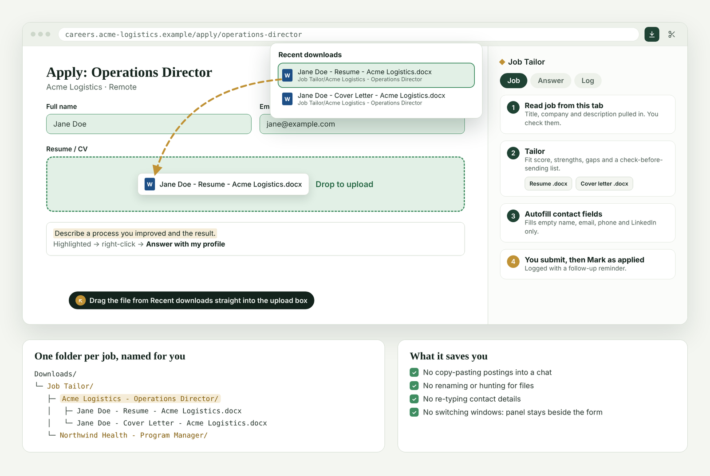

# How it works: the Job Tailor guide

This guide covers installing Job Tailor in Brave, Chrome or Edge, setting it up, using each tab, and changing it to suit you.

**Contents**

1. [Before you start](#1-before-you-start)
2. [Install it](#2-install-it) (developer mode required)
3. [Set it up](#3-set-it-up)
4. [Tailor an application](#4-tailor-an-application)
5. [Answer application questions](#5-answer-application-questions)
6. [Track your applications](#6-track-your-applications)
7. [Make it yours with AI](#7-make-it-yours-with-ai)
8. [Update, troubleshoot or remove](#8-update-troubleshoot-or-remove)
9. [Using it responsibly](#9-using-it-responsibly)

---

## 1. Before you start

You need three things:

- **A Chromium browser, version 116 or later:** Brave, Google Chrome or Microsoft Edge.
- **A Claude API key** from the [Claude Console](https://console.anthropic.com/). The API is billed separately from a Claude.ai subscription. Set a **monthly spend limit** on the key in the Console before you start.
- **Your career record as text files** (`.md` or `.txt`). The more complete and accurate it is, the better the drafts. A Word document works if you save it as plain text first.

> **Work or school computer?** Many managed devices block developer mode or unpacked extensions through IT policy. If the toggle in step 2 is greyed out or missing, use a personal device or ask your IT team.

---

## 2. Install it

Job Tailor isn't in an extension store, so you install it from its folder. Every Chromium browser needs **developer mode** turned on to do that.

### Get the files

1. On the [repository page](https://github.com/CAITOUS/JobTailor), click **Code → Download ZIP**.
2. Unzip it to a folder you'll keep, for example `Documents/JobTailor`.
3. Open the folder and make sure you can see `manifest.json`. If you only see one folder inside, that inner folder is the one to load.

> ⚠️ **Don't move or delete the folder after installing.** The browser runs the extension from that folder. If it moves, the extension stops working until you load it again.

### Brave

1. Go to `brave://extensions` (paste it into the address bar).
2. ⚠️ **Turn on Developer mode** with the toggle in the **top-right** corner.
3. Click **Load unpacked** (top-left) and choose the Job Tailor folder.
4. Click the puzzle-piece icon in the toolbar and **pin** Job Tailor.

Brave's built-in sidebar is separate from the extension side panel. If Brave can't open Job Tailor in a side panel, it opens in a small window instead. Everything works the same way.

### Google Chrome

1. Go to `chrome://extensions`.
2. ⚠️ **Turn on Developer mode** with the toggle in the **top-right** corner.
3. Click **Load unpacked** (top-left) and choose the Job Tailor folder.
4. Click the puzzle-piece icon in the toolbar and **pin** Job Tailor.

Chrome may show a notice about extensions in developer mode. That's expected for anything installed from a folder. Keep developer mode on, or the extension may be turned off.

### Microsoft Edge

1. Go to `edge://extensions`.
2. ⚠️ **Turn on Developer mode** with the toggle in the **left-hand menu** (at the bottom of the list). On a narrow window, open the menu with the ☰ icon first.
3. Click **Load unpacked** (it appears at the top once developer mode is on) and choose the Job Tailor folder.
4. Click the puzzle-piece (Extensions) icon in the toolbar and set Job Tailor to **Show in toolbar**.

You don't need Edge's "Allow extensions from other stores" setting. That's only for installing from the Chrome Web Store.

### Check it worked

The **Options** page opens automatically the first time. If it doesn't, right-click the Job Tailor icon and choose **Options**.

---

## 3. Set it up

On the Options page:

| Setting | What to enter |
|---|---|
| **API key** | Your Claude API key (`sk-ant-...`). Click **Test key** to confirm it works. |
| **Model** | Which Claude model writes your resume and cover letter, and which answers questions. The default balances quality and cost. |
| **Your details** | Name, email, phone, location, LinkedIn and website. These go on your documents and fill empty contact fields. |
| **Career source files** | Upload your `.md` or `.txt` files. This is the complete record Job Tailor works from. It won't use anything that isn't in here. |
| **Rules** | Plain-language rules that override everything else, such as how to show a title or what never to mention. Edit these to match your own record. |
| **Known answers** | Facts you've confirmed for common questions, such as notice period or work arrangement. Questions that depend on a fact that isn't here get flagged **NEEDS YOU** instead of guessed. |
| **Follow-up days** | How long after applying before the Log flags a job for follow-up (default 10). |

**Tip: correct once, apply everywhere.** When you spot the same mistake twice, fix the rule or the source file, not just the document. Every later application is then right.

---

## 4. Tailor an application

1. Open a job posting. Job Tailor reads **Indeed, LinkedIn, Greenhouse, Lever and Workday** directly. On other sites it uses the page's structured job data, or the page text.
2. Press **Alt+J** or click the Job Tailor icon to open the panel.
3. Click **Read job from this tab**. **Check the title, company and description** and fix anything it got wrong.
4. Add optional notes for this job (for example, "lead with the compliance work").
5. Click **Tailor**. You'll get:
   - a **fit score** (0–100) and a short summary
   - your **strengths** and **gaps** for this role
   - a **Check before sending** list of anything it condensed or inferred
   - a resume and cover letter as Word files, saved to `Downloads/Job Tailor/<Company> - <Title>/`
6. **Open both files, read them and edit them.** Then apply on the employer's site yourself.

### The one-window workflow

- **Click straight through the side panel.** It stays open beside the posting or form: **Read job from this tab → Tailor → Autofill contact fields → Mark as applied.**
- **One folder per job.** Files save to `Downloads/Job Tailor/<Company> - <Title>/` as `<Your name> - Resume - <Company>.docx` and `<Your name> - Cover Letter - <Company>.docx`, so you always know which version went where.
- **Drag and drop to upload.** Open your browser's downloads list (the download icon in the toolbar, or `Ctrl+J` / `Cmd+Shift+J`) and drag the resume or cover letter straight into the application's upload box. This works in Brave, Chrome and Edge. If a site doesn't accept dropped files, use its **Upload** button and open the job's folder.

Your rules and source files are cached by the API, so tailoring several jobs in a row costs less than the first.

---

## 5. Answer application questions

1. On an application form, **highlight the question**.
2. Right-click → **Answer with my profile**.
3. Choose a length if you want, review the draft, then click **Insert into field**. If no field is selected, click the field you want it in.

If an answer depends on something only you know (salary, work authorization, sponsorship, start date, relocation, EEO, references or any yes/no eligibility question), it's flagged **NEEDS YOU**. The missing fact appears in `[BRACKETS]` for you to fill in.

**Autofill contact fields** fills only *empty* name, email, phone and LinkedIn fields. It never overwrites anything and never submits.

---

## 6. Track your applications

The **Log** tab lists every job you've tailored. After you submit on the employer's site, click **Mark as applied** on the Job tab. Change each job's status as it moves: tailored, applied, interviewing, offer, rejected or withdrawn. Applied jobs are flagged for follow-up after your set number of days. Click **Export CSV** to take the log into a spreadsheet.

---

## 7. Make it yours with AI

Job Tailor is plain HTML, CSS and JavaScript with **no build step**, so it's easy to change, even if you don't code. You're encouraged to make it your own.

### How to do it

1. Download the ZIP (or fork the repository on GitHub if you use Git).
2. **Upload the folder or the files you want to change to your AI assistant**, such as Claude, ChatGPT or Gemini. A Claude Project works well: add the files once and ask for changes over several chats.
3. Describe the change in plain words. Ask it to return the **complete updated file**.
4. Replace the old file in your Job Tailor folder.
5. Open your browser's extensions page and click the **reload** icon (↻) on the Job Tailor card.
6. Test it on a real posting. If something breaks, paste the error from the panel back into the chat.

### Where things live

| File | What it controls |
|---|---|
| `manifest.json` | Name, version, permissions and the Alt+J shortcut |
| `lib/prompts.js` | The instructions sent to Claude: tone, resume length, cover-letter style, what gets flagged |
| `lib/store.js` | Default settings and the default rules |
| `lib/extract.js` | How each job site is read (`SITES` at the top) and how contact fields are autofilled |
| `lib/docx.js` | The layout of the Word documents |
| `lib/claude.js` | API calls, the model list and cost estimates |
| `panel.html`, `panel.js`, `panel.css` | The side panel: Job, Answer and Log tabs |
| `options.html`, `options.js` | The Options page |
| `background.js` | Opening the panel and the right-click menu |

### Example requests

- *"Here's `lib/extract.js`. Add support for job postings on [site]. Here's the page's HTML."*
- *"Here's `lib/docx.js`. Change the resume to a two-column header with my name on the left and contact details on the right."*
- *"Here's `lib/prompts.js`. Make the cover letter three paragraphs and under 250 words."*
- *"Here's `lib/store.js`. Replace the default rules with these: [your rules]."*
- *"Here's `panel.js` and `panel.html`. Add an 'Interview notes' field to each job in the Log tab."*

**Keep the guardrails.** If you change the prompts, keep the instructions that stop it inventing facts and that flag NEEDS YOU questions. They're what keep your applications honest.

---

## 8. Update, troubleshoot or remove

**Update:** download the new ZIP and replace the files in your existing folder (your settings are stored in the browser, not the folder). Then click **reload** (↻) on the Job Tailor card in your extensions page.

**Change the shortcut:** go to `brave://extensions/shortcuts`, `chrome://extensions/shortcuts` or `edge://extensions/shortcuts`.

| Problem | Fix |
|---|---|
| **Load unpacked** is missing | Turn on Developer mode first (step 2). |
| "Manifest file is missing or unreadable" | You picked the wrong folder. Choose the one that directly contains `manifest.json`. |
| Developer mode is greyed out | Your device is managed by an organization. Use a personal device or ask IT. |
| Extension disappeared or stopped working | The folder was moved or deleted, or developer mode was turned off. Restore the folder and load it again. |
| "Can't access this page" | Browser pages (`brave://`, `chrome://`, `edge://`) and extension stores can't be read. Open the job on the employer's or job board's site. |
| **Read job** gets the wrong text | The site changed its layout. Fix the fields by hand, or update `SITES` in `lib/extract.js` (section 7). |
| API key error | Click **Test key** in Options. Check the key, your Console billing and your spend limit. |
| "The response was cut off" | Lower the effort level in Options, or trim very long source files. |

**Remove:** on your extensions page, click **Remove** on the Job Tailor card. This also deletes its stored settings and log, so export your log to CSV first.

---

## 9. Using it responsibly

Job Tailor is a writing assistant, not an auto-applier.

- **You submit.** It never clicks submit, creates accounts or applies in bulk.
- **You verify.** Read every document and answer before it goes out. The fit score, gaps and "check before sending" list are there to help you do that.
- **It stays truthful.** It only uses what's in your source files and reports gaps instead of covering them. Keep your source files accurate.
- **Follow each site's terms.** You're responsible for how you use any tool on a job site.

You're responsible for everything you send. Job Tailor just gets you to a strong first draft faster.
