# Job Tailor user manual

**Version 1.1** · Brave, Google Chrome and Microsoft Edge

Job Tailor helps you apply for jobs faster while staying in charge of every word. It reads the posting you have open and drafts a tailored resume and cover letter from *your* career record. It drafts answers to application questions, learns more about you each time you fill a gap, and logs where you've applied. **It never submits anything for you.**

> All screenshots use made-up sample data (Jane Doe, Acme Logistics). Numbered callouts match the list beside each image.

**Contents**

1. [Install](#1-install)
2. [Set up in the Options window](#2-set-up-in-the-options-window)
3. [The side panel at a glance](#3-the-side-panel-at-a-glance)
4. [Tailor an application](#4-tailor-an-application)
5. [The one-window workflow: folders and drag-and-drop](#5-the-one-window-workflow-folders-and-drag-and-drop)
6. [Progressive context: turn gaps into facts](#6-progressive-context-turn-gaps-into-facts)
7. [Answer application questions](#7-answer-application-questions)
8. [Autofill contact fields](#8-autofill-contact-fields)
9. [Track applications in the Log](#9-track-applications-in-the-log)
10. [Change rules, files and instructions anytime](#10-change-rules-files-and-instructions-anytime)
11. [Back up, restore and update](#11-back-up-restore-and-update)
12. [Make it yours with AI](#12-make-it-yours-with-ai)
13. [Privacy and responsible use](#13-privacy-and-responsible-use)

---

## 1. Install

Job Tailor installs from a folder, so your browser needs **developer mode** turned on. ⚠️ This is required in every browser.

1. Download **`JobTailor-<version>.zip`** from the [latest release](https://github.com/CAITOUS/JobTailor/releases/latest) and unzip it to a place you'll keep (for example `Documents`). It contains one folder, `JobTailor`.
2. Open your browser's extensions page and turn on **Developer mode**.
3. Click **Load unpacked** and choose the `JobTailor` folder (it contains `manifest.json`).
4. Pin Job Tailor to your toolbar.

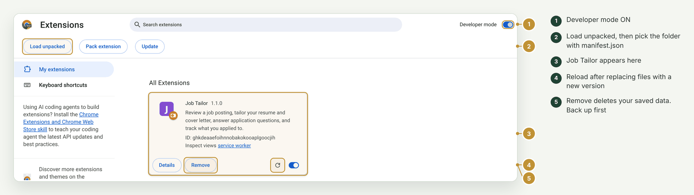

| Browser | Extensions page | Where the Developer mode toggle is |
|---|---|---|
| Brave | `brave://extensions` | Top-right corner |
| Google Chrome | `chrome://extensions` | Top-right corner |
| Microsoft Edge | `edge://extensions` | Left-hand menu, near the bottom (open it with ☰ on a narrow window) |

> ⚠️ **Work or school device?** IT policy may block developer mode. If the toggle is greyed out, use a personal device or ask IT.
>
> ⚠️ **Never click Remove to update.** Removing the extension deletes your settings, context and log. See [section 11](#11-back-up-restore-and-update).

The Options window opens automatically the first time.

---

## 2. Set up in the Options window

Open Options any time with the **Options** button at the top of the panel, or by right-clicking the toolbar icon. Everything saves as you type.

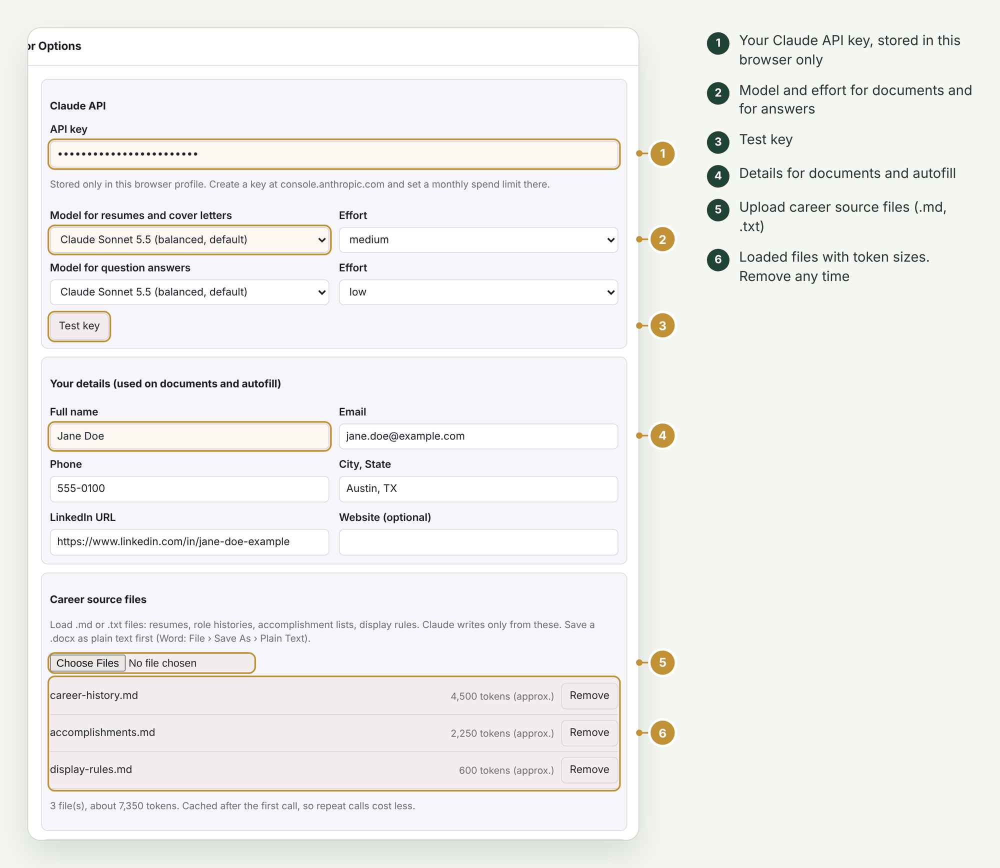

- **Claude API key.** Create one at [console.anthropic.com](https://console.anthropic.com/) and **set a monthly spend limit** there. The key is stored only in this browser profile. Click **Test key** to check it.
- **Models and effort.** Choose separately for resumes and cover letters and for question answers. Higher effort is more thorough and costs more.
- **Your details.** Your name and contact details go on your documents and are used for autofill.
- **Career source files.** Upload `.md` or `.txt` files: role histories, accomplishment lists, display rules. Job Tailor writes *only* from these and your saved context. To use a Word document, save it as plain text first (**File › Save As › Plain Text**).

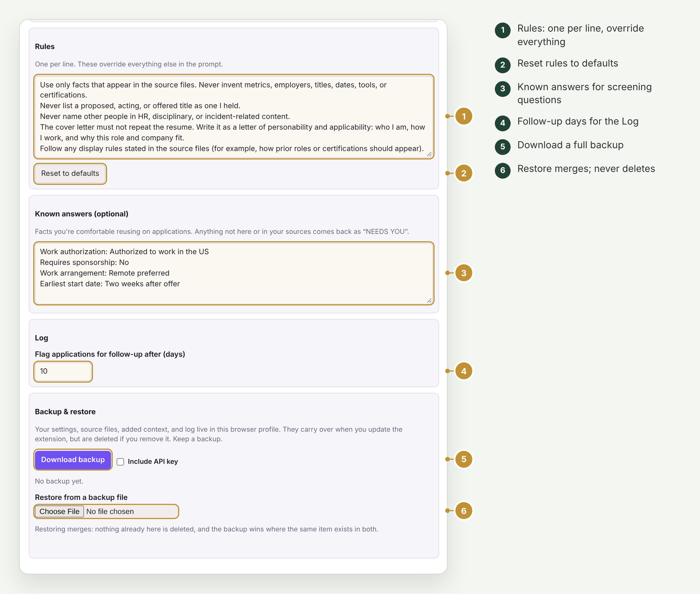

- **Rules.** One per line. They override everything else, for example "Never list a proposed title as one I held."
- **Known answers.** Facts you're comfortable reusing on screening questions, such as work authorization or notice period. Anything that isn't here or in your sources comes back flagged **NEEDS YOU**.
- **Follow-up days.** How long after applying before the Log flags a job.
- **Backup & restore.** See [section 11](#11-back-up-restore-and-update).

---

## 3. The side panel at a glance

Open a job posting and press **Alt+J**, or click the Job Tailor icon. The panel opens beside the page and stays there while you work. If your browser can't show side panels, it opens in a small window instead.

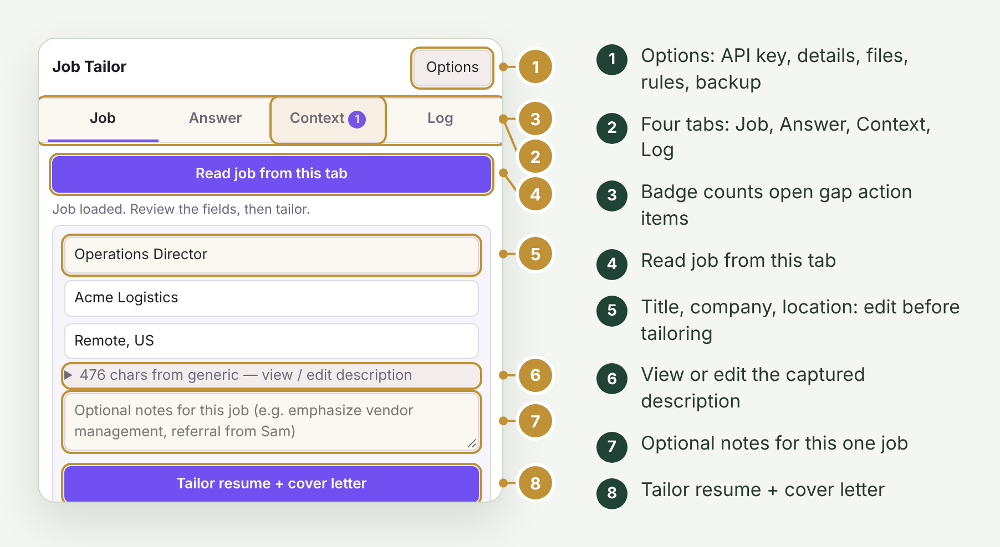

| Tab | Use it to |
|---|---|
| **Job** | Read the posting, tailor your documents, autofill and mark as applied |
| **Answer** | Draft answers to application questions in your voice |
| **Context** | Add facts and work through gaps you've flagged. The badge counts open items |
| **Log** | Track stage, follow-ups, contacts and notes, and export to CSV. The badge counts follow-ups due |

---

## 4. Tailor an application

1. Click **Read job from this tab**. Job Tailor reads Indeed, LinkedIn, Greenhouse, Lever and Workday directly. On other sites it uses the page's structured job data, or the page text.
2. **Check the title, company, location and description**, and fix anything it got wrong.
3. Optionally add notes for this job, for example "lead with the compliance work."
4. Click **Tailor resume + cover letter**. It usually takes 30–90 seconds. The status line shows the approximate cost.

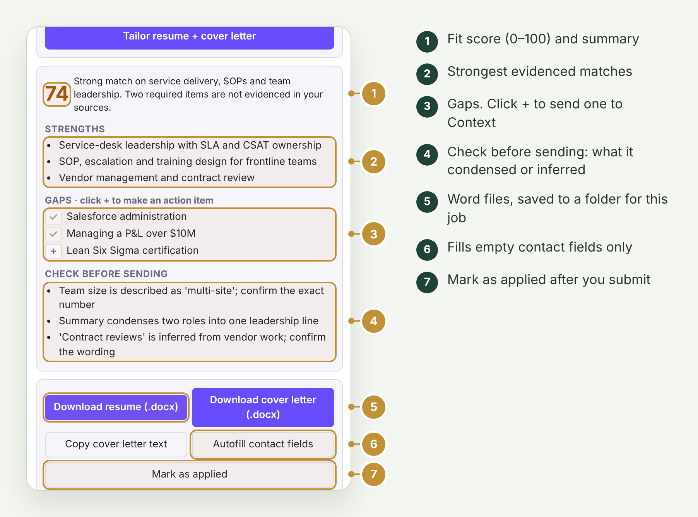

- **Fit score and summary:** an honest read of how well your record covers the must-haves.
- **Strengths:** your best evidenced matches.
- **Gaps:** requirements your record doesn't show. Click **+** to work on one (see [section 6](#6-progressive-context-turn-gaps-into-facts)).
- **Check before sending:** anything it condensed, inferred or worded closely. Read these first.
- **Download** the resume and cover letter as Word files, or **Copy cover letter text** for a text box.
- **Preview resume text** shows the content without opening the file.

**Always open, read and edit both documents before you apply.**

---

## 5. The one-window workflow: folders and drag-and-drop

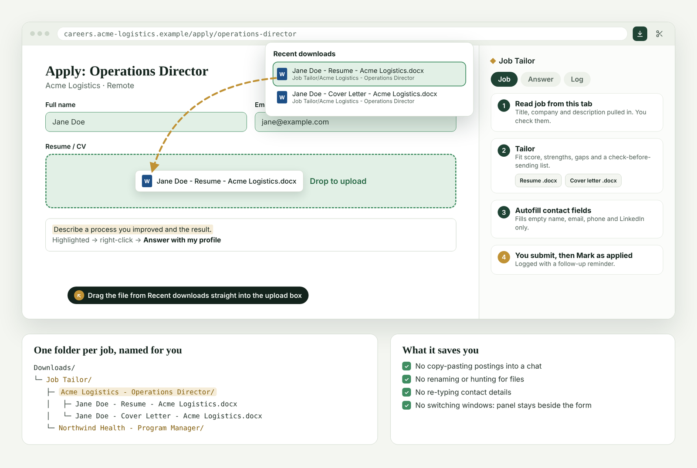

- **Click straight through the panel:** Read job → Tailor → Download → Autofill → *you submit* → Mark as applied. The posting and the form stay in view.
- **One folder per job, named for you:**

  ```
  Downloads/
  └─ Job Tailor/
     ├─ Acme Logistics - Operations Director/
     │  ├─ Jane Doe - Resume - Acme Logistics.docx
     │  └─ Jane Doe - Cover Letter - Acme Logistics.docx
     ├─ Northwind Health - Program Manager/
     └─ backups/
  ```

- **Drag and drop to upload.** Open your browser's recent downloads (the download icon in the toolbar, or `Ctrl+J` / `Cmd+Shift+J`) and drag the file straight into the application's upload box. If a site doesn't accept dropped files, use its **Upload** button and open the job's folder.

---

## 6. Progressive context: turn gaps into facts

Your source files won't cover everything. Job Tailor helps you fill them in over time, one gap at a time, so every later application is better informed.

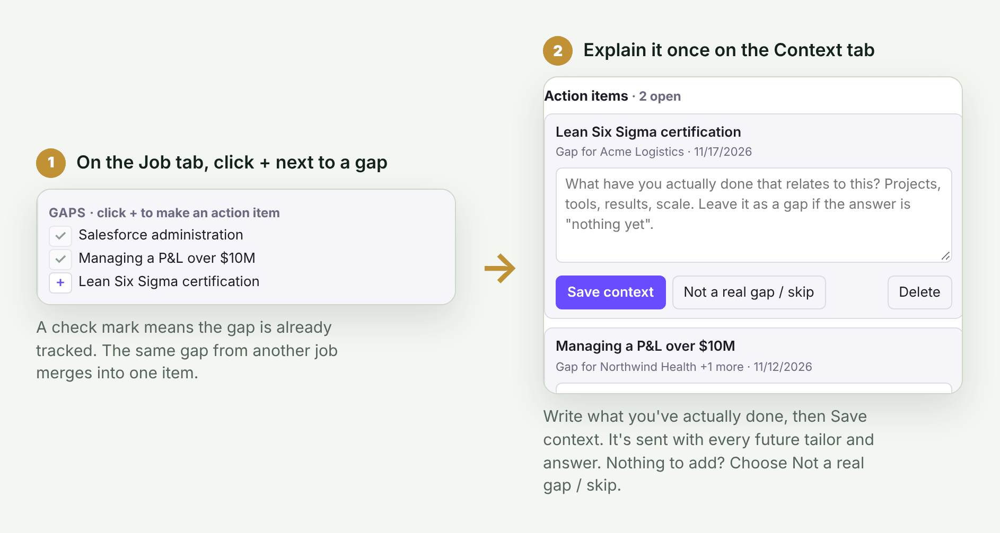

**How it works**

1. On the Job tab, click **+** next to a gap. It becomes an **action item** on the Context tab, and the badge on the tab counts it. A ✓ means the gap is already tracked. If the same gap shows up for another job, it merges into the existing item and lists every job that raised it.
2. On the Context tab, write what you've actually done that relates to it: projects, tools, results, scale. Click **Save context**.
3. If you really haven't done it, click **Not a real gap / skip**. If it comes up again later, it reopens.
4. To use new context on the job you're working on, **tailor it again**.

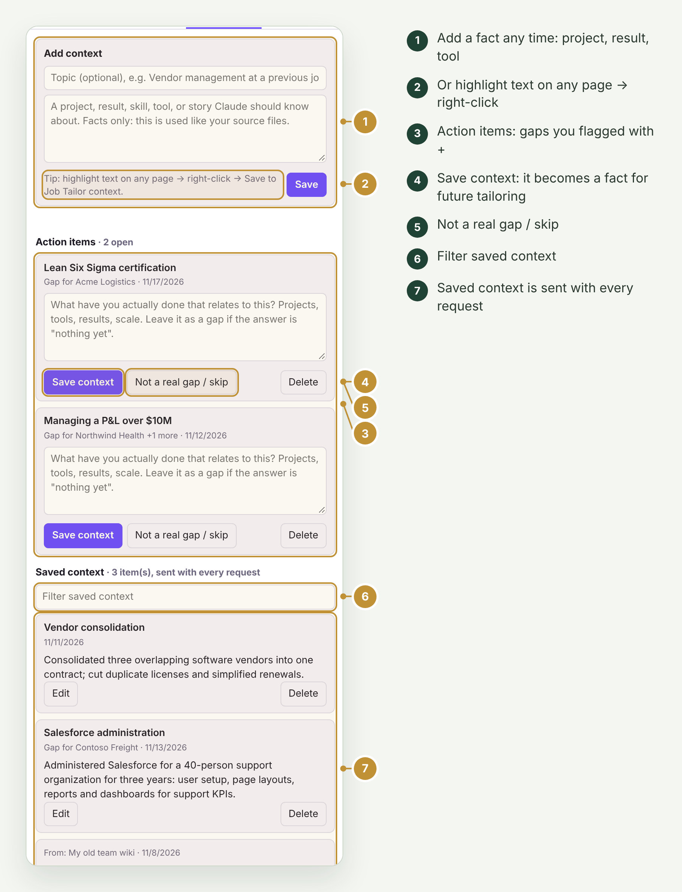

**Other ways to add context**

- **Type it in.** Use **Add context** at the top of the tab, with an optional topic.
- **Save it from any page.** Highlight text, right-click, and choose **Save to Job Tailor context**. It's saved with a link to the page it came from, and the toolbar icon flashes **+1**.

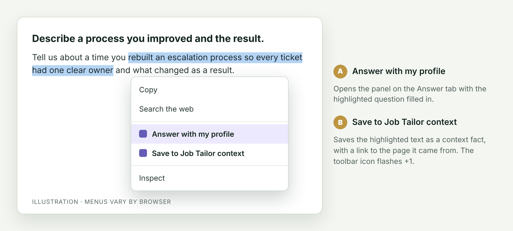

**What happens to context.** Saved context is sent with **every** tailor and answer request, and treated exactly like your source files. Skipped items are not sent. Use **Filter** to find items, and **Edit** or **Delete** to keep them accurate. Gap names are kept short and reusable, so you'll recognize the same requirement across postings.

> **Facts only.** Context is used as evidence. Write what's true, at the level it's true.

---

## 7. Answer application questions

1. On an application page, highlight a question, right-click, and choose **Answer with my profile**. The panel opens on the Answer tab with the question filled in. You can also paste or type a question.
2. Choose a **length** (auto, short, medium or long). Keep **Use current job** ticked to tailor the answer to the posting you read.
3. Click **Answer**, then review and edit the draft.
4. Click a field on the page, then **Insert into field**, or click **Copy**.

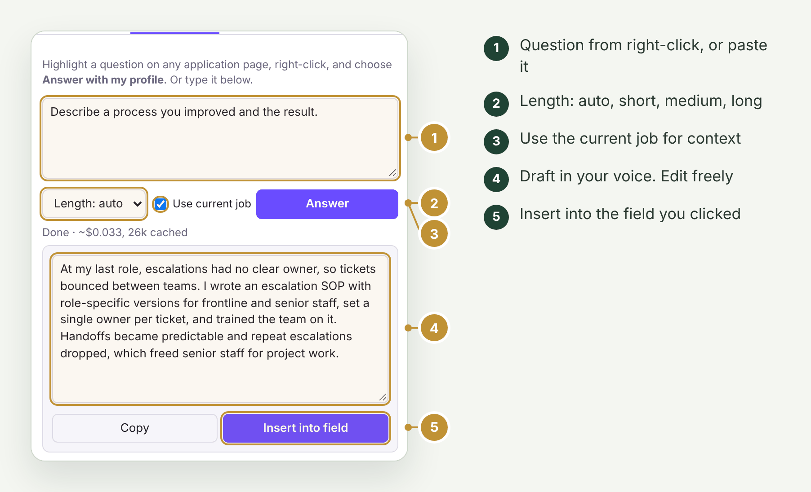

**NEEDS YOU.** If a truthful answer depends on something only you know, such as salary, work authorization, sponsorship, start date, relocation, EEO questions, references or any yes/no eligibility question, the answer is flagged **NEEDS YOU**. The missing fact appears in `[BRACKETS]`. Add facts you're happy to reuse to **Known answers** in Options.

---

## 8. Autofill contact fields

Click **Autofill contact fields** on the Job tab to fill **empty** name, email, phone and LinkedIn fields on the current page. It never overwrites what's there, and it never submits.

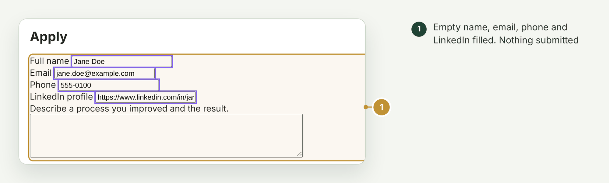

---

## 9. Track applications in the Log

Every job you tailor is added to the Log. After you submit on the employer's site, click **Mark as applied** on the Job tab. That starts the follow-up clock.

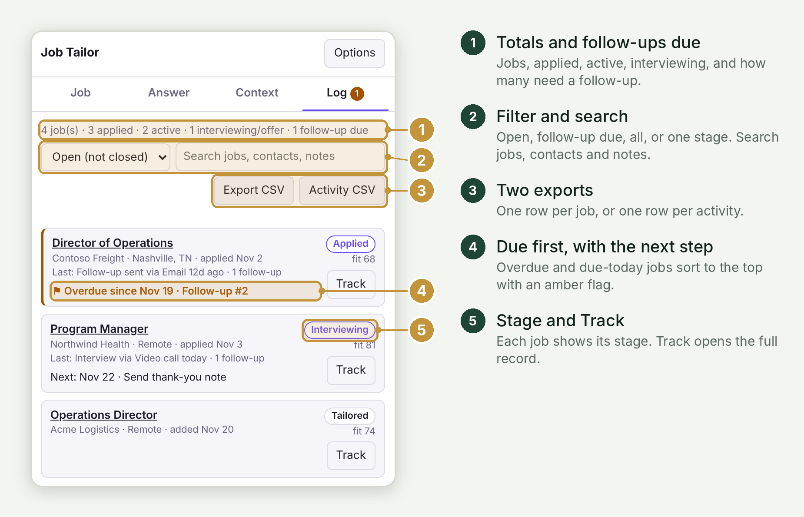

**The list** answers "what do I do today?"
- Jobs with a follow-up due come first, with an orange edge and **⚑ Due today** or **⚑ Overdue since…**. Then upcoming follow-ups, then everything else.
- Each job shows its stage, when you applied, your last contact (what, how, how long ago), how many follow-ups you've sent, and the next step.
- The number on the **Log** tab, and on the toolbar icon, is how many follow-ups are due.
- Filter by **Open**, **Follow-up due**, **All** or one stage, or search titles, companies, contacts and notes.

**Click Track** on a job to open it:

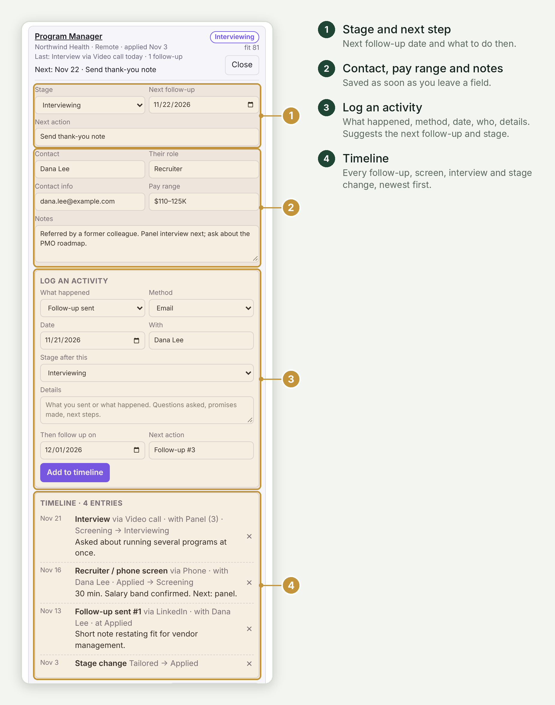

- **Stage:** tailored, applied, screening, interviewing, offer, accepted, rejected, withdrawn or no response. Every change is added to the timeline. Closed stages (accepted, rejected, withdrawn, no response) stop the follow-up reminders.
- **Next follow-up** and **Next action:** the date you'll be reminded and what to do then.
- **Contact, their role, contact info, pay range and notes.** These save as soon as you leave the field.

**Log an activity** each time something happens:

| What happened | Suggested next step |
|---|---|
| Follow-up sent | Next follow-up after your default gap (Options › Log), numbered #1, #2, #3… |
| They responded | Reply / schedule in 2 days |
| Recruiter / phone screen | Thank-you note tomorrow; stage moves to Screening |
| Interview | Thank-you note tomorrow; stage moves to Interviewing |
| Thank-you sent | Check in on the decision in 7 days |
| Offer received | Respond in 2 days; stage moves to Offer |
| Rejection | Stage moves to Rejected; reminders stop |
| Note | Leaves the next step as it is |

Pick the **method** (email, LinkedIn, phone, text, portal, video call, in person, referral), the date, who it was with, and the details. The suggested stage and next follow-up fill in for you; change them before you click **Add to timeline** if they don't fit. **✕** removes a timeline entry.

**Export:** **Export CSV** saves one row per job, including follow-up counts, last contact, next step and the full timeline. **Activity CSV** saves one row per follow-up, screen, interview or note.

---

## 10. Change rules, files and instructions anytime

Everything that shapes your documents can be changed in the **Options** window, right in the browser. You don't need to edit any code.

| To change… | Go to Options › | Takes effect |
|---|---|---|
| What it must never say, or how titles and dates appear | **Rules** (Reset to defaults restores the starting set) | Your next tailor or answer |
| What it knows about your career | **Career source files** (upload, replace by uploading the same file name, or Remove) | Your next tailor or answer |
| Reusable screening answers | **Known answers** | Your next answer |
| Writing quality and cost | **Model** and **Effort** | Your next request |
| Name and contact details on documents | **Your details** | Your next download or autofill |
| Default days between follow-ups | **Log** | Immediately |

Facts you add on the **Context** tab work alongside all of these. To change the underlying instructions, layout or supported sites, see [section 12](#12-make-it-yours-with-ai).

---

## 11. Back up, restore and update

Your settings, source files, context and log live in your browser profile. They **carry over when you update** the extension, but **are deleted if you remove it.**

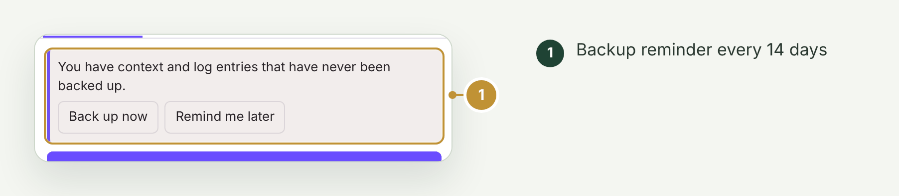

- **Back up:** Options › **Download backup**, or **Back up now** in the panel when it reminds you (every 14 days once you have context or log entries). Backups save to `Downloads/Job Tailor/backups/`. Your API key is left out unless you tick **Include API key**.
- **Restore:** Options › **Restore from a backup file**. Restoring **merges**. Nothing already there is deleted, and the backup wins where the same item exists in both.
- **Update:** back up, download the new zip from [Releases](https://github.com/CAITOUS/JobTailor/releases/latest), replace the files in your folder (a new folder works too), then click **Reload** (↻) on the Job Tailor card in your extensions page. Accept any new permission it asks for. See [what's new](../CHANGELOG.md). The extension's ID is fixed in `manifest.json`, so your data stays connected. **Don't click Remove.**

---

## 12. Make it yours with AI

Job Tailor is plain HTML, CSS and JavaScript with no build step. Download it, upload the files to your own AI assistant (Claude, ChatGPT or similar), and ask for the changes you want. Replace the files, then click **Reload** (↻) on the extension card. The [guide](GUIDE.md#7-make-it-yours-with-ai) has a file map and example requests.

**Keep the guardrails.** If you change the prompts, keep the instructions that stop it inventing facts and that flag NEEDS YOU. They keep your applications honest.

---

## 13. Privacy and responsible use

- **Local by default.** Your key, details, files, context and log are stored in your browser profile. The only outside connection is the Claude API, using your own key.
- **You submit.** Job Tailor never clicks submit, creates accounts or applies in bulk.
- **You verify.** Read every document and answer before it goes out. The fit score, gaps and "check before sending" list are there to help.
- **Truthful by design.** It writes only from your source files and saved context, and reports gaps instead of covering them.
- **Follow each site's terms.** You're responsible for what you send and how you use any tool on a job site.

Troubleshooting: see the [guide](GUIDE.md#8-update-troubleshoot-or-remove).
